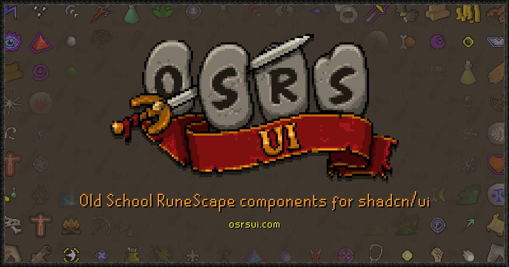

# OSRS UI

Old School RuneScape's interface as a [shadcn/ui](https://ui.shadcn.com) registry: buttons, windows, tabs, the chatbox, orbs, skill tiles and more, traced pixel for pixel into vector SVG and built on [Base UI](https://base-ui.com).

**Docs and live examples: [osrsui.com](https://osrsui.com)**



## What's in it

- **Components.** Every control from the game, each with a live playground: buttons, sprite buttons, toggles, checkboxes, sliders, selects, tabs, windows, side panels, the chatbox and NPC dialogue, context menus, tooltips, orbs, XP drops, item and equipment slots, skill tiles and more.
- **Recipes.** Whole screens assembled from the components (the Bank, Grand Exchange, All Settings, Collection Log, World Switcher and others), ready to copy into your app.
- **Assets.** Over a thousand sprites, frames and textures. Download any of them as SVG or as a crisp PNG at any whole-number scale, free for videos, thumbnails and stream overlays.

Everything is vector and drawn on a pixel grid, so it stays sharp at 1x, 2x, 3x and beyond. Frames are 9-slice, so windows and panels resize without stretching their corners.

## Install

You need a project that already uses shadcn/ui with Tailwind v4 ([setup guide](https://ui.shadcn.com/docs/installation)).

Add the theme. It brings the tokens, frames, textures and fonts in one CSS file:

```bash
npx shadcn@latest add https://osrsui.com/r/osrs-theme.json
```

Import it after Tailwind in your global CSS:

```css
@import "tailwindcss";
@import "../styles/osrs.css";
```

Then add components one at a time. They're copied into your project and are yours to edit:

```bash
npx shadcn@latest add https://osrsui.com/r/button.json
```

Every component page in the docs has its own install command.

## Theming

`--osrs-px` is the size of one game pixel, and everything is measured in it. Keep it a whole number of CSS pixels so edges stay crisp:

```css
:root { --osrs-px: 2px; }            /* default */
.minimap-overlay { --osrs-px: 1px; } /* native size */
```

Add the `osrs` class to a container to map the shadcn tokens (`--background`, `--primary`, …) to the game's palette. See [Getting Started](https://osrsui.com/getting-started#theming) for the palette and utility classes.

## Developing

```bash
pnpm install
pnpm dev          # the docs site at http://localhost:4321
pnpm build        # CSS, search index, assets, the registry (public/r) and the site (dist/)
pnpm typecheck
pnpm verify:pixels
```

| Path | What's there |
| --- | --- |
| `registry/osrs/ui/` | The components and generated sprite sets |
| `registry/osrs/theme/` | `base.css` (hand-written) and `osrs.css` (built by `scripts/build-css.ts`) |
| `docs/` | The docs pages (MDX) |
| `examples/` | The live demos on each component page |
| `site/` | The docs site's own components: header, sidebar, homepage, search |
| `scripts/` | The asset pipeline: sprite tracing, CSS, registry and asset exports |

The site URL lives in `site/site-url.ts`. When the domain changes, update it there and regenerate the share image (`public/og.png`) from `site/og/OgImages.tsx`.

## Credits

- Made by [Austin Robinson](https://github.com/austinmrobinson)
- Fonts: [RuneStar](https://github.com/RuneStar/fonts) (CC0)
- Sprite reference: [melkypie/resource-packs](https://github.com/melkypie/resource-packs)
- Item icons and data: [OSRS Wiki](https://oldschool.runescape.wiki)
- Code font: [Departure Mono](https://departuremono.com) by Helena Zhang (SIL OFL)

## License

The code is MIT. The traced art is Jagex's.

Unofficial fan content, not endorsed by or affiliated with Jagex. Created using intellectual property belonging to Jagex Limited under the terms of Jagex's Fan Content Policy. This project is non-commercial.
